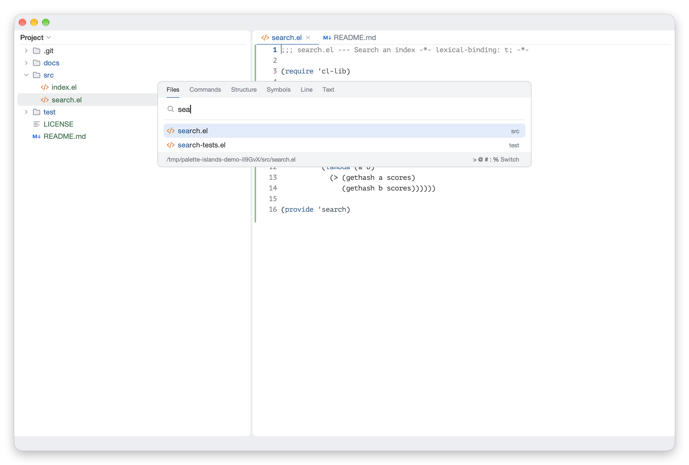
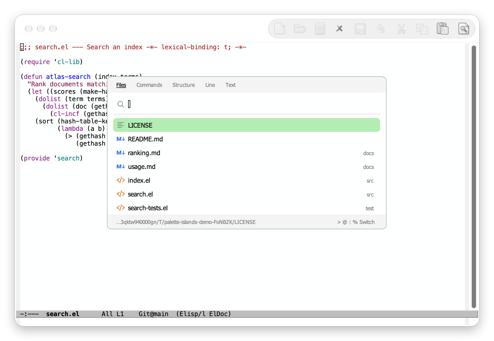

# palette-islands

English | [简体中文](README.zh-CN.md)



A JetBrains-style floating panel for the Emacs minibuffer, on top of
[Vertico](https://github.com/minad/vertico) and
[posframe](https://github.com/tumashu/posframe).

- **Floating panel**: the minibuffer shows in a child frame with rounded
  corners, a header, a divider and a footer. Focus never leaves the editor, so
  key maps, input methods and recursive minibuffers keep working.
- **Two placements**: `palette` at the top of the frame, and `point` under the
  symbol at point or a button.
- **Search window**: one window for files, commands, structure, line and text,
  as in Search Everywhere and VS Code's quick open. A typed prefix switches the
  kind; tabs in the header show it and switch on click.
- **Candidates**: names before their faded directories, icons of files and
  buffers, and in the footer the selected one's full location or documentation,
  as in JetBrains' Search Everywhere.

Every minibuffer that reads through Vertico gets the panel, with no changes to
the commands. On text terminals the minibuffer stays in the echo area.

## Without an Emacs configuration

The title image above uses a personal Emacs configuration. Here is Palette
Islands in `emacs -Q`, loading only the package and its dependencies, with
default fonts, faces and toolbar. [Reproduce this demo](docs/screenshots.md).



## Requirements

- Emacs 29.1 or later, with SVG support for the corners, the selected row and
  icons. It is tested on Emacs 31.1 only; please report problems on older versions
- [Vertico](https://github.com/minad/vertico) 2.0 or later
- [posframe](https://github.com/tumashu/posframe) 1.4 or later
- [expui-icons](https://github.com/wwulfric/expui-icons) 0.2.2 or later
- Optional: [Consult](https://github.com/minad/consult), for richer search kinds

The panel relies on internals of its dependencies: it advises
`vertico--display-candidates`, `vertico--format-candidate`,
`vertico--format-group-title`, `vertico--resize-window` and
`posframe--fit-frame-to-buffer`, and reads `vertico--index`, `vertico--metadata`
and `posframe--frame`. It is tested with Vertico 2.15 and posframe 1.5.3; other
versions may need changes.

## Install

With `package-vc` (Emacs 29):

```elisp
(package-vc-install "https://github.com/wwulfric/palette-islands")
```

Or from a checkout:

```elisp
(add-to-list 'load-path "/path/to/palette-islands")
(require 'palette-islands)
```

Loading changes nothing, and nothing is bound by default. Turn on the mode,
then bind the commands you want, or the whole map under a prefix:

```elisp
(vertico-mode 1)
(palette-islands-mode 1)
(keymap-global-set "C-c p" palette-islands-command-map)
;; Or as in VS Code:
(keymap-global-set "s-p" #'palette-islands-search)
```

| Key in the map | Command |
|---|---|
| `s` | `palette-islands-search`: search, starting on files |
| `f` | `palette-islands-search-files`: go to file |
| `x` | `palette-islands-search-commands`: run a command |
| `i` | `palette-islands-search-structure`: this file's structure |
| `l` | `palette-islands-search-line`: go to line |
| `t` | `palette-islands-search-text`: find in the project |

In the search window, type a prefix into the empty input to switch kinds:

| Prefix | Kind |
|---|---|
| none | Files |
| `>` | Commands |
| `@` | Structure |
| `:` | Line |
| `%` | Text |

Backspace in the empty input goes back to files. Text searches may start with
any character, so there another prefix needs that Backspace first.

## Fitting it into a configuration

The package supplies usable defaults, and the panel never calls into your
configuration: editor integration goes through the variables below, and styling
uses package faces. Nothing changes the global theme, font or mode line.

### Search kinds

`palette-islands-search-kinds` lists the kinds, as `(KIND PREFIX LABEL COMMAND)`.
Each command reads from the minibuffer. The defaults use only built-in commands,
and there is no kind for the project's symbols, because how to find them depends
on your setup.

To add one, write a command and name it as a kind. This complete example uses
only built-in xref, which asks the current buffer's backend for its identifiers:
Emacs Lisp buffers list Lisp symbols, and other backends list what they offer.

```elisp
(require 'palette-islands-search)
(require 'xref)

(defun my-workspace-symbol ()
  "Go to a symbol, chosen from the current xref backend's identifiers."
  (interactive)
  (let ((xref-prompt-for-identifier t))
    (call-interactively #'xref-find-definitions)))

(add-to-list 'palette-islands-search-kinds
             '(symbols "#" "Symbols" my-workspace-symbol) t)
(palette-islands-search-define symbols)
```

Typing `#` now switches to it. `palette-islands-search-define` also makes a command
that opens the window on that kind, here `palette-islands-search-symbols`, for
binding to a key. Commands exist already for the default kinds. Any command that
reads from the minibuffer will do, such as one calling your language server client.

To search with Consult, replace the commands of the default kinds:

```elisp
(setq palette-islands-search-kinds
      '((files nil "Files" project-find-file)
        (commands ">" "Commands" execute-extended-command)
        (structure "@" "Structure" consult-imenu)
        (line ":" "Line" consult-goto-line)
        (text "%" "Text" consult-ripgrep)))
```

Keep the kind `files`: Backspace goes back to it.

### Size and position

Width is in columns, row heights in frame character units, and the rest in
pixels unless its docstring says otherwise:

```elisp
(setq palette-islands-top 0.12                 ; Fraction of the frame height.
      palette-islands-width '(0.55 72 . 120)   ; (FRACTION MIN . MAX)
      palette-islands-point-width '(48 . 100)  ; (MIN . MAX)
      palette-islands-rows '((palette . 14) (point . 8))
      palette-islands-radius 8
      palette-islands-row-height 1.85)
```

These apply from the next panel opened. See also
`palette-islands-header-height`, `palette-islands-header-padding`,
`palette-islands-input-height`, `palette-islands-input-padding`,
`palette-islands-group-row-height`, `palette-islands-divider-height` and
`palette-islands-edge-height`.

### Colors and fonts

Load your theme before these snippets. `custom-set-faces` records user face
specs, which take precedence over theme faces. Use both light and dark clauses
if you switch themes:

```elisp
(custom-set-faces
 '(palette-islands-font ((t (:family "sans-serif"))))
 '(palette-islands-border
   ((((background dark)) (:background "#43454A"))
    (t (:background "#C9CCD6"))))
 '(palette-islands-footer
   ((((background dark)) (:background "#2B2D30"))
    (t (:background "#F2F3F5")))))
```

`palette-islands-font` is the font of interface text; keep it limited to font
attributes. The other faces, in the `palette-islands` group, are
`palette-islands` for the panel's text and background, `-edge` (which follows
`-border`), `-title`, `-divider`, `-tab`, `-tab-active` and `-header`. The
selected row takes its color from Vertico's `vertico-current`.

[examples/style.el](examples/style.el) combines these settings into an optional,
standalone file. Load it after your theme
with `(load "/path/to/palette-islands/examples/style.el")`.

### Editor integration

| Variable | Contract and default |
|---|---|
| `palette-islands-background-function` | No arguments; returns an Emacs color string or `nil`. Called when the panel shows; its cut-off corners paint this color. Default `nil` uses the default face's background. |
| `palette-islands-icon-function` | Receives a candidate; returns a string displaying an image, or `nil`. Default `palette-islands-candidate-icon` shows icons of files and buffers. Set `nil` for none. |
| `palette-islands-detail-function` | Receives a candidate; returns its location or description for the footer, or `nil`. Default `palette-islands-candidate-detail` knows files, buffers, matches and documented symbols. Set `nil` for none. |
| `palette-islands-project-root-function` | No arguments; returns a directory or `nil`. Candidates' directories show relative to it. Default `nil` uses the project of the buffer the minibuffer was opened from. |
| `palette-islands-titles` | Panel titles by command. |
| `palette-islands-category-titles` | Panel titles by completion category, for completions no command opened. Other panels take their prompt as title. |
| `palette-islands-ignore-commands` | Commands whose minibuffer stays in the echo area. Default empty. |
| `palette-islands-actions` | Keys named at the right of the footer, by command, as `(KEY DESCRIPTION)`. |

### For other packages

Let-bind `palette-islands-placement` around code that reads from the minibuffer
(`palette`, `point`, or `nil` for the echo area), and `palette-islands-anchor` to
drop a panel from a button. In the minibuffer, `palette-islands-set-status`,
`palette-islands-set-action`, `palette-islands-set-tabs` and
`palette-islands-set-prefix` fill the header and footer.

To lay out candidates of your own, `palette-islands-indent` is the pixels before
their text, `palette-islands-text-width` the columns for it, and
`palette-islands-candidates-text-end` the `:align-to` position where right-aligned
text ends. A candidate can choose its icon and footer with the text properties
`palette-islands-icon`, an expui icon's name, and `palette-islands-detail`.

A command whose candidates arrive later, such as from a language server, can
reopen its kind by `palette-islands-search-run`, with the input it was opened with
from `palette-islands-search-take-input`.

## Development

```sh
make compile   # byte-compile, warnings as errors
make test      # run the ERT suite
```

The Makefile looks for dependencies under `DEPS`, one directory each:
by default beside this checkout, as when it is a submodule next to
Vertico and posframe.  Point it elsewhere with, say,
`make test DEPS=~/.emacs.d/elpa`.

## License

Apache License 2.0; see [LICENSE](LICENSE).
