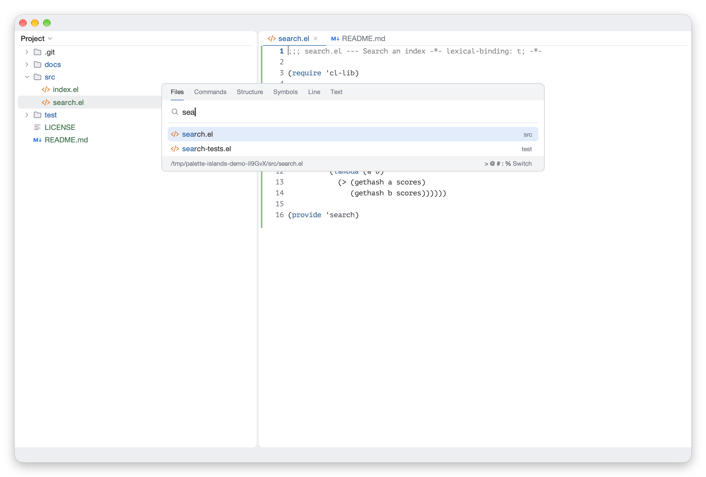
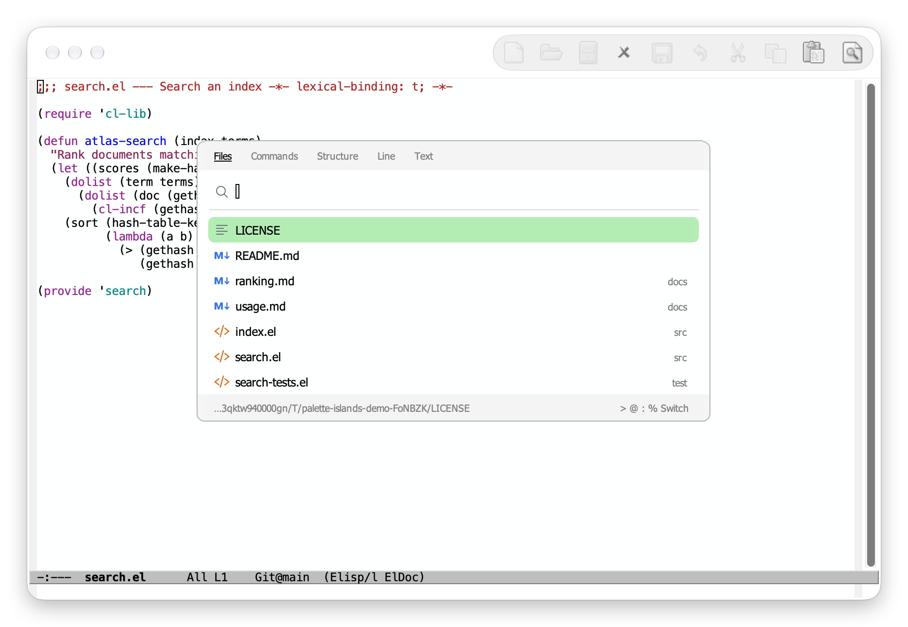

# palette-islands

[English](README.md) | 简体中文



为 Emacs minibuffer 提供 JetBrains 风格的浮动面板，基于
[Vertico](https://github.com/minad/vertico) 和
[posframe](https://github.com/tumashu/posframe)。

- **浮动面板**：minibuffer 显示在带圆角、页眉、分隔线和页脚的子窗口里。焦点始终留在
  编辑器，所以键位、输入法和递归 minibuffer 都照常工作。
- **两种位置**：`palette` 在窗口顶部，`point` 在光标处的符号或按钮下方。
- **搜索窗口**：一个窗口搜索文件、命令、结构、行和文本，类似 Search Everywhere 和
  VS Code 的 quick open。输入前缀可切换类型；页眉的标签显示当前类型，也能点击切换。
- **候选项**：文件名在前、目录淡化靠右，文件和 buffer 带图标，页脚显示选中项的完整位置或文档，
  类似 JetBrains 的 Search Everywhere。

所有通过 Vertico 读取的 minibuffer 都会显示为面板，无需改动命令本身。
在文本终端里 minibuffer 留在回显区。

## 不加载个人配置的效果

上方题图使用了个人 Emacs 配置。下图是在 `emacs -Q` 中仅加载 Palette Islands
及其依赖的真实截图，保留默认字体、配色和工具栏。
[复现这个演示](docs/screenshots.md)。



## 依赖

- Emacs 29.1 或更高版本，需支持 SVG（用于绘制圆角、选中行和图标）。目前只在 Emacs 31.1 上测试过，
  旧版本如有问题欢迎反馈
- [Vertico](https://github.com/minad/vertico) 2.0 或更高版本
- [posframe](https://github.com/tumashu/posframe) 1.4 或更高版本
- [expui-icons](https://github.com/wwulfric/expui-icons) 0.2.2 或更高版本
- 可选：[Consult](https://github.com/minad/consult)，提供更丰富的搜索类型

面板依赖其依赖包的内部实现：advice 了 `vertico--display-candidates`、
`vertico--format-candidate`、`vertico--format-group-title`、`vertico--resize-window` 和
`posframe--fit-frame-to-buffer`，并读取 `vertico--index`、`vertico--metadata` 和
`posframe--frame`。已在 Vertico 2.15 和 posframe 1.5.3 上测试，其他版本可能需要调整。

## 安装

用 `package-vc`（Emacs 29）安装：

```elisp
(package-vc-install "https://github.com/wwulfric/palette-islands")
```

或者从本地 checkout 加载：

```elisp
(add-to-list 'load-path "/path/to/palette-islands")
(require 'palette-islands)
```

加载本身不改变任何行为，默认也不绑定按键。开启模式后，可以单独绑定需要的命令，
或把整个按键表挂在一个前缀下：

```elisp
(vertico-mode 1)
(palette-islands-mode 1)
(keymap-global-set "C-c p" palette-islands-command-map)
;; 或者沿用 VS Code 的按键：
(keymap-global-set "s-p" #'palette-islands-search)
```

| 按键表中的键 | 命令 |
|---|---|
| `s` | `palette-islands-search`：搜索，从文件开始 |
| `f` | `palette-islands-search-files`：跳转到文件 |
| `x` | `palette-islands-search-commands`：执行命令 |
| `i` | `palette-islands-search-structure`：当前文件的结构 |
| `l` | `palette-islands-search-line`：跳转到行 |
| `t` | `palette-islands-search-text`：在项目中查找 |

在搜索窗口的空输入里键入前缀可切换类型：

| 前缀 | 类型 |
|---|---|
| 无 | 文件 |
| `>` | 命令 |
| `@` | 结构 |
| `:` | 行 |
| `%` | 文本 |

在空输入里按 Backspace 回到文件。文本搜索可以以任意字符开头，所以从文本切到其他类型
要先按一次 Backspace。

## 融入个人配置

包自带可用的默认值，面板也不会调用你的配置：与编辑器的对接都通过下面的变量，样式都通过
包自己的 face。它不会改动全局主题、字体或 mode line。

### 搜索类型

`palette-islands-search-kinds` 列出各类型，格式为 `(KIND PREFIX LABEL COMMAND)`，
每个命令都从 minibuffer 读取。默认只用内置命令，也没有项目符号这个类型，因为查找符号的方式
取决于你的环境。

要添加这个类型，写一个命令，再把它登记为类型即可。下面是完整的例子，只用内置的 xref，
它向当前 buffer 的后端查询标识符：Emacs Lisp buffer 列出 Lisp 符号，其他后端列出各自提供的内容。

```elisp
(require 'palette-islands-search)
(require 'xref)

(defun my-workspace-symbol ()
  "Go to a symbol, chosen from the current xref backend's identifiers."
  (interactive)
  (let ((xref-prompt-for-identifier t))
    (call-interactively #'xref-find-definitions)))

(add-to-list 'palette-islands-search-kinds
             '(symbols "#" "Symbols" my-workspace-symbol) t)
(palette-islands-search-define symbols)
```

之后输入 `#` 就会切换到这个类型。`palette-islands-search-define` 还会生成直接打开该类型的命令，
这里是 `palette-islands-search-symbols`，可以绑定到按键。默认类型的命令已经存在。
任何从 minibuffer 读取的命令都可以，比如调用语言服务器客户端的命令。

要改用 Consult 搜索，替换默认类型的命令：

```elisp
(setq palette-islands-search-kinds
      '((files nil "Files" project-find-file)
        (commands ">" "Commands" execute-extended-command)
        (structure "@" "Structure" consult-imenu)
        (line ":" "Line" consult-goto-line)
        (text "%" "Text" consult-ripgrep)))
```

请保留 `files` 类型，Backspace 会回到它。

### 尺寸和位置

宽度以列为单位，行高以窗口字符高度为单位，其余除文档字符串另有说明外都以像素为单位：

```elisp
(setq palette-islands-top 0.12                 ; 占窗口高度的比例
      palette-islands-width '(0.55 72 . 120)   ; (比例 最小 . 最大)
      palette-islands-point-width '(48 . 100)  ; (最小 . 最大)
      palette-islands-rows '((palette . 14) (point . 8))
      palette-islands-radius 8
      palette-islands-row-height 1.85)
```

设置从下一次打开面板起生效。另见 `palette-islands-header-height`、
`palette-islands-header-padding`、`palette-islands-input-height`、
`palette-islands-input-padding`、`palette-islands-group-row-height`、
`palette-islands-divider-height` 和 `palette-islands-edge-height`。

### 颜色和字体

请先加载主题，再使用下面的片段。`custom-set-faces` 记录的用户 face 优先于主题 face。
如果会切换主题，请同时写亮色和暗色分支：

```elisp
(custom-set-faces
 '(palette-islands-font ((t (:family "sans-serif"))))
 '(palette-islands-border
   ((((background dark)) (:background "#43454A"))
    (t (:background "#C9CCD6"))))
 '(palette-islands-footer
   ((((background dark)) (:background "#2B2D30"))
    (t (:background "#F2F3F5")))))
```

`palette-islands-font` 是界面文字的字体，请只设置字体属性。`palette-islands` 分组里
其他的 face 有：面板文字和背景 `palette-islands`，以及 `-edge`（跟随 `-border`）、
`-title`、`-divider`、`-tab`、`-tab-active` 和 `-header`。选中行的颜色取自 Vertico 的
`vertico-current`。

[examples/style.el](examples/style.el) 把这些设置合成一个可选的独立文件。
在主题之后用 `(load "/path/to/palette-islands/examples/style.el")` 加载。

### 与编辑器对接

| 变量 | 约定和默认值 |
|---|---|
| `palette-islands-background-function` | 无参数，返回 Emacs 颜色字符串或 `nil`。面板显示时调用，切掉的圆角涂这个颜色。默认 `nil` 用 default face 的背景。 |
| `palette-islands-icon-function` | 接收候选项，返回显示图片的字符串或 `nil`。默认 `palette-islands-candidate-icon` 显示文件和 buffer 的图标。设为 `nil` 不显示。 |
| `palette-islands-detail-function` | 接收候选项，返回页脚显示的位置或说明，或 `nil`。默认 `palette-islands-candidate-detail` 支持文件、buffer、搜索结果和有文档的符号。设为 `nil` 不显示。 |
| `palette-islands-project-root-function` | 无参数，返回目录或 `nil`。候选项的目录相对它显示。默认 `nil` 用打开 minibuffer 的 buffer 所在项目。 |
| `palette-islands-titles` | 按命令指定面板标题。 |
| `palette-islands-category-titles` | 按补全类别指定标题，用于不是由命令打开的补全。其余面板以 prompt 为标题。 |
| `palette-islands-ignore-commands` | 这些命令的 minibuffer 留在回显区。默认为空。 |
| `palette-islands-actions` | 按命令指定页脚右侧显示的按键，格式为 `(KEY DESCRIPTION)`。 |

### 供其他包使用

在读取 minibuffer 的代码外 let 绑定 `palette-islands-placement`（`palette`、`point`，
或 `nil` 表示回显区），用 `palette-islands-anchor` 让面板从按钮下方弹出。在 minibuffer 里，
`palette-islands-set-status`、`palette-islands-set-action`、`palette-islands-set-tabs`
和 `palette-islands-set-prefix` 用于填写页眉和页脚。

要自己排版候选项：`palette-islands-indent` 是文字前的像素，`palette-islands-text-width` 是可用列数，
`palette-islands-candidates-text-end` 是右对齐文字结束处的 `:align-to` 位置。候选项可以用文本属性
`palette-islands-icon`（expui 图标名）和 `palette-islands-detail` 指定自己的图标和页脚。

候选项稍后才到的命令（比如来自语言服务器），可以用 `palette-islands-search-run` 重新打开所属类型，
打开时的输入从 `palette-islands-search-take-input` 取得。

## 开发

```sh
make compile   # 字节编译，警告视为错误
make test      # 运行 ERT 测试
```

Makefile 在 `DEPS` 下查找依赖，每个依赖一个目录：默认是这个 checkout 的同级目录，
也就是作为 submodule 放在 Vertico 和 posframe 旁边的情况。可以指向其他位置，
例如 `make test DEPS=~/.emacs.d/elpa`。

## 许可证

Apache License 2.0，见 [LICENSE](LICENSE)。
